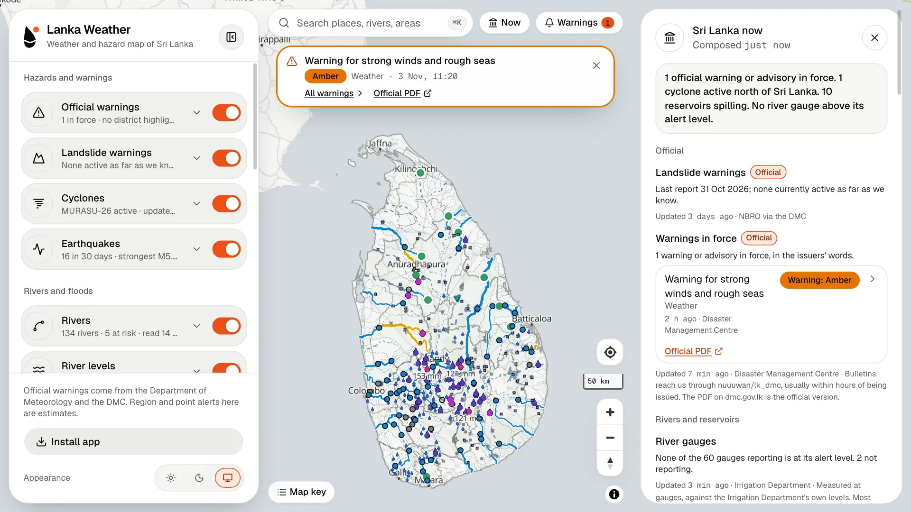

# lanka-weather

A weather and disaster early-warning portal for Sri Lanka. It gathers
forecasts, observations and hazard data from public sources into one
interactive map, so that people can see what is happening now and what
is likely to happen next in their area.

Live at **<https://weather.prabhavalabs.com>**. It installs as an app on a
phone or a computer, works offline and can send push alerts.

> [!WARNING]
> **Not an official warning service.** Lanka Weather is an independent,
> open-source project. It is not run by or affiliated with the
> Department of Meteorology, the Disaster Management Centre (DMC), NBRO or
> the Irrigation Department.
>
> - Official warnings from the [Department of Meteorology](https://www.meteo.gov.lk)
>   and the [DMC](https://www.dmc.gov.lk) always take precedence.
> - Anything marked "Estimate" is worked out by this software and may be
>   wrong, late or missing. Sources can go stale or offline without notice.
> - Do not rely on it as your only source for life-safety decisions.
>   **In an emergency, call 117.**
>
> The software is provided "as is", without warranty of any kind (see
> [LICENSE](LICENSE)).



## Purpose

Sri Lanka has frequent, often sudden, severe weather: monsoon floods,
landslides, cyclones and strong winds. The relevant information already
exists but is spread across many sources and formats. This project
brings those sources together, normalises them, and presents them as
layers on a single map of Sri Lanka, with warnings that are easy to
understand.

Layers on the map today:

- weather by region and as a smooth field (temperature, rain, humidity,
  cloud, wind), with a 72-hour and 7-day forecast at any point;
- animated GFS wind with a 72-hour time scrubber;
- Google Flood Forecasting gauges and flood areas;
- river levels from the Irrigation Department and waterlevels.lk, with
  flood status and trend; reservoirs and Colombo's canals;
- live rain gauges and satellite rainfall (NASA IMERG);
- DMC and Department of Meteorology warnings, NBRO landslide levels,
  cyclones (GDACS) and earthquakes (USGS);
- air quality and sea conditions;
- a situation overview and a flood-risk estimate for each district.

The interface is in English, Sinhala and Tamil. See
`docs/architecture/overview.md` for how it fits together, and
`docs/data-sources.md` for every source.

## Repository layout

| Path | Contents |
|---|---|
| `cmd/lankaweather/` | Go entry point: `migrate`, `serve`, `worker` and `collect` |
| `internal/` | Go packages: layer catalogue, HTTP API, connectors, ingest, store, regions and place search, weather grid and services |
| `apps/web/` | Front end: React, Vite, TanStack Query with a persisted IndexedDB cache, MapLibre, shadcn/ui |
| `brand/` | Logo, wordmark and icon sources, with usage and colours |
| `docs/` | Architecture overview, data-source catalogue and decision records |
| `deploy/` | How the maintainers' instance is deployed (Docker Compose and nginx) |
| `.github/` | CI workflow, issue and pull-request templates |

## Not versioned

The following are deliberately kept out of Git (see `.gitignore`):

- downloaded or derived data, caches and research material (`data/`,
  `cache/`, `research/`, raster and tile files);
- secrets and local configuration (`.env*`, keys, credentials).

Use `.env.example` files to document required configuration.

## Getting started

Prerequisites: Go (the version in `go.mod`), Node.js 24 or later, pnpm (enabled
through Corepack: `corepack enable`) and Docker.

```bash
cp .env.example .env   # local settings; .env is never committed
make bootstrap         # install Node and Go dependencies
make db-up             # PostgreSQL with PostGIS on 127.0.0.1:55440
make collect           # migrate, then fetch every source once (a few minutes;
                       # about 470 of Open-Meteo's 10,000 free daily calls)
make dev-api           # terminal 1: API on http://localhost:8080
make dev-worker        # terminal 2: scheduler that keeps data current
make dev-web           # terminal 3: web app on http://localhost:5173
```

No API keys are needed. The Google flood forecast and push notifications
stay off until their keys are set in `.env`; see `.env.example`. Set
`LANKAWEATHER_CONTACT` to your own URL or email address: it is sent to every
data source, so their operators can reach whoever runs the instance.

The Vite dev server proxies `/v1` and `/healthz` to the API. Set
`LANKAWEATHER_API_URL` to point it elsewhere, and `LANKAWEATHER_ADDR` to
change the API's listen address.

In development, `http://localhost:5173/?kit` shows the design kit: every
component in the current theme with placeholder data. After changing the
artwork in `brand/`, regenerate the icons with
`pnpm --filter @lanka-weather/web icons`.

### Commands

| Command | Purpose |
|---|---|
| `lankaweather migrate` | Apply database migrations |
| `lankaweather serve` | HTTP API |
| `lankaweather worker` | Scheduler: runs each collector at its interval; one leader across replicas |
| `lankaweather collect` | Run every collector once and exit |

### API

The web app reads only from this API. A few of the main endpoints:

| Endpoint | Returns |
|---|---|
| `GET /healthz`, `GET /readyz` | Liveness; readiness including the database |
| `GET /v1/layers` | Layer catalogue with refresh cadence and staleness limits |
| `GET /v1/summary?lat=&lon=` | One place: its regions, weather, nearest river and flood gauges, alerts |
| `GET /v1/weather/point?lat=&lon=` | Current conditions, a 72-hour hourly and a 7-day daily forecast |
| `GET /v1/rivers/levels` | River gauging stations as GeoJSON: level, flood status, trend, data age |
| `GET /v1/floods/forecast` | Google flood forecasts for Sri Lanka as GeoJSON |
| `GET /v1/places/search?q=kandy` | Cities, towns, villages and regions by name, typo-tolerant |

Region ids are Department of Census and Statistics codes: `LK-2`
(province), `LK-21` (district), `LK-2130` (DS division), `LK-2130120`
(GN division). Every endpoint is documented, with example responses, in
[docs/api/](docs/api/overview.md).

### Web application

One map of Sri Lanka with weather by region (province, district, DS or GN
division), a smooth weather field (temperature, rain, humidity, cloud or
wind), animated GFS wind with a 72-hour time scrubber, Google flood
forecasts and river levels. Search with ⌘K or Ctrl+K; click the map, a
region or a gauge for its weather, 72-hour and 7-day forecast, nearby
gauges and alerts. Alerts derived by lanka-weather are labelled
"Estimate"; official warnings come from the Department of Meteorology
and the DMC. A selection is kept in the URL, for example
`/?at=7.2931,80.6350&name=Kandy`, `/?region=LK-21`,
`/?station=peradeniya` or `/?gauge=hybas_4121155030`. ADR 0009 records
how the map is put together.

Before opening a pull request, run everything CI runs:

```bash
make ci          # format, lint, type checks, generated-code check, tests, builds;
                 # integration tests too when LANKAWEATHER_TEST_DATABASE_URL is set
```

## Contributing

Contributions are welcome: bug reports, data corrections, translations
and code. [CONTRIBUTING.md](CONTRIBUTING.md) explains how to set up, the
branch and commit conventions, and how pull requests are reviewed. Please
follow the [code of conduct](CODE_OF_CONDUCT.md), and report security
problems privately as described in [SECURITY.md](SECURITY.md).

## Data sources and attribution

The code licence does not cover the data. Each source keeps its own
licence and terms, and the app credits the source of every layer. The
main ones:

| Source | Terms |
|---|---|
| OpenStreetMap, through OpenFreeMap (basemap, places, reservoirs) | ODbL; © OpenStreetMap contributors |
| Open-Meteo (weather grid, air quality, sea) | CC BY 4.0; free tier for non-commercial use only. Air quality: Copernicus Atmosphere Monitoring Service |
| Google Flood Forecasting API | Google's terms; needs your own key, and results are kept no longer than 24 hours |
| NOAA GFS (wind), USGS (earthquakes) | Public domain |
| NASA GIBS IMERG (satellite rain), GDACS (cyclones) | Free to use with attribution |
| HydroSHEDS (HydroRIVERS, HydroBASINS) | Free with attribution (Lehner and Grill, 2013) |
| Administrative boundaries (lk_admin_regions, OCHA HDX) | CC BY-IGO; Survey Department and Department of Census and Statistics |
| Department of Meteorology, DMC, NBRO, Irrigation Department | Public government information, credited and linked; no licence is published |
| waterlevels.lk, HMIS rain gauges | Community and agency data, credited; no licence is published |
| Nuwan Senaratna's Sri Lanka data repositories ([nuuuwan](https://github.com/nuuuwan): `lk_dmc`, `lk_dmc_landslides`, `weather_lk`, `lk_weather_3h`, `lk_admin_regions`, `lk_census_2024`, `lk_rivers`) | Code under MIT; the data stays with the agencies above. Much of the official data reaches us through these copies, with thanks |

The full list, with access methods and the exact attribution text, is in
[docs/data-sources.md](docs/data-sources.md). The app shows the same
credits, the privacy notes and the disclaimer on its About page
(`/?about`, or the ⓘ button in the sidebar). If you run your own
instance, follow each source's terms and rate limits.

## Licence

Lanka Weather is licensed under the [Apache License 2.0](LICENSE). Parts
of the code are derived from other Apache-2.0 work; see [NOTICE](NOTICE).
The project name and the artwork in `brand/` are not licensed as
trademarks.
